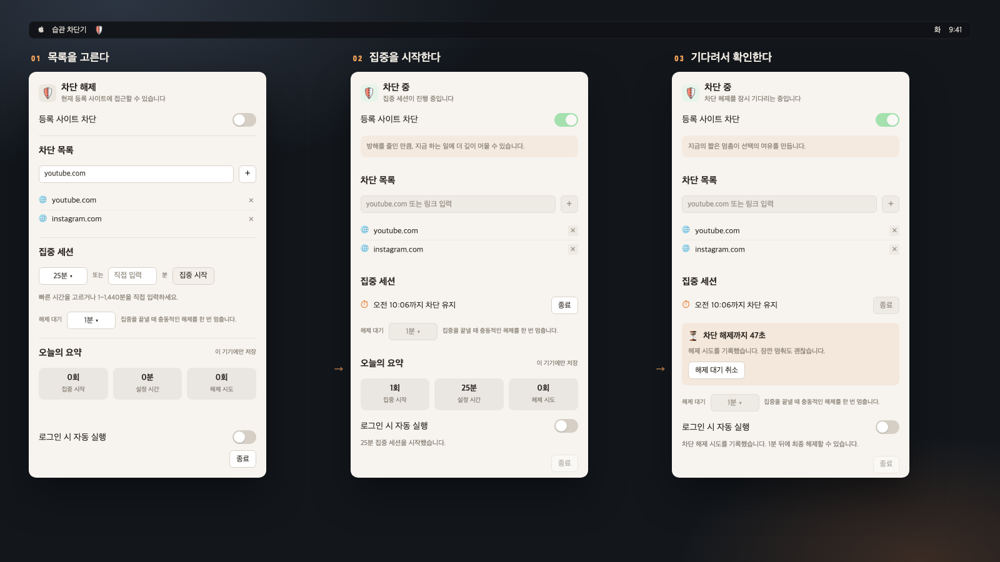

# 습관 차단기

집중하는 동안 지정한 웹사이트를 차단하는 macOS 메뉴 막대 앱입니다.

[English](README.md)

## 요구 사항

- macOS 14 이상
- 소스 빌드에 필요한 Xcode 또는 Swift가 포함된 Xcode Command Line Tools
- 차단 규칙을 적용하거나 해제할 때 관리자 인증

## 빌드와 실행

```zsh
git clone https://github.com/hyuunnn/habitblocker.git
cd habitblocker
./Scripts/build.sh
open Build/HabitBlocker.app
```

실행하면 메뉴 막대에 방패 아이콘이 나타납니다.

## 사용 방법

1. 메뉴 막대 아이콘을 열고 **차단 목록**에 `youtube.com` 같은 도메인이나 URL을 추가합니다. URL은 도메인으로 저장되며, 해당 도메인과 하위 도메인의 모든 페이지가 차단됩니다.
2. 차단 방식을 선택합니다.

   - **등록 사이트 차단**: 해제 대기 없이 차단을 켜거나 끕니다.
   - **집중 시작**: 25·45·60분을 선택하거나 1~1,440분을 입력합니다. 차단이 꺼져 있어야 시작할 수 있고, 시간이 끝나면 앱이 차단 해제를 시도합니다.

3. 집중 세션을 중간에 끝내려면 **종료**를 누르고, 설정한 대기 시간이 지난 뒤 **차단 해제**를 누릅니다. 해제 대기는 30초·1분·5분 중에서 선택합니다.

집중 시간이 끝날 때도 차단 해제를 위한 관리자 인증이 요청될 수 있습니다. 인증을 취소하거나 해제가 실패하면 차단이 남을 수 있습니다. 해제 대기 중에 집중 시간이 끝나도 **차단 해제**를 눌러야 합니다.

차단 목록과 해제 대기 시간은 차단이 꺼져 있을 때만 바꿀 수 있습니다. 집중 세션이나 해제 대기 중에는 차단 스위치가 잠깁니다. 차단이나 집중 세션이 진행 중이거나 규칙을 적용하는 동안에는 앱의 종료 버튼을 사용할 수 없습니다.

**오늘의 요약**에는 집중 시작 횟수, 세션 종료나 차단 해제 시 기록한 실제 경과 시간, 해제 시도가 표시됩니다. 활동 기록은 이 Mac에만 저장하고, 지난 날짜의 기록은 자동으로 정리합니다.

**로그인 시 자동 실행**을 켜면 로그인 후 앱이 실행됩니다. 집중 알림을 받으려면 macOS 알림 권한을 허용해야 합니다.



## 차단 방식과 제약

습관 차단기는 macOS의 프록시 자동 설정(PAC)을 사용합니다. 사용 설정된 네트워크 서비스의 자동 프록시 구성을 앱이 `127.0.0.1:47471`에서 제공하는 스크립트로 바꿉니다. 등록한 도메인은 요청을 거부하는 로컬 서버로 보내고, 나머지는 직접 연결합니다. `/etc/hosts`는 수정하지 않습니다.

설정을 바꾸기 전에 이전 자동 프록시 설정을 백업하며, PAC 적용을 확인하지 못하면 복원을 시도합니다. 차단 해제는 이전 설정을 복원하고 결과를 확인한 뒤에 완료됩니다.

- 시스템 프록시 설정을 따르는 클라이언트에 적용됩니다. 이를 무시하는 앱·명령줄 도구·VPN 구성은 차단을 우회할 수 있습니다.
- 브라우저의 기존 연결은 잠시 유지될 수 있습니다. 새 연결에 차단이 적용되는지 확인하려면 브라우저를 완전히 종료한 뒤 다시 여세요.
- 차단된 HTTPS 사이트에는 브라우저의 연결 오류가 표시됩니다. 앱의 차단 페이지는 HTTP에서 볼 수 있습니다.
- 차단을 유지하려면 앱을 켜 두세요. 충돌이나 강제 종료 뒤에는 차단을 보장할 수 없고 프록시 설정이 남을 수 있습니다. 앱을 다시 실행하면 로컬 서버를 재시작하고 차단을 관리할 수 있습니다. `47471` 포트가 다른 프로그램과 충돌해도 로컬 서버가 동작하지 않을 수 있습니다.

차단 해제에 실패하면 앱의 오류 메시지와 macOS 시스템 설정에서 사용 중인 네트워크 서비스의 자동 프록시 구성을 확인하세요. 앱은 복원이 확인될 때까지 프록시 백업을 보관합니다.

## 개발

```zsh
./Scripts/test.sh
```

`Tests/HabitBlockerCoreTests.swift`는 관리자 인증 없이 실행됩니다. 국제화 도메인을 포함한 도메인 정규화, PAC 매칭과 요청 파싱, 네트워크 서비스 파싱, 집중 시간 계산, 프록시 백업·복원, 관리자 스크립트 생성을 검증합니다.

앱 코드는 `Sources/HabitBlocker/`에 있습니다.

| 파일 | 역할 |
|---|---|
| `HabitBlockerApp.swift`, `MenuContentView.swift` | 앱 진입점과 메뉴 막대 화면 |
| `BlockerStore.swift` | 차단 상태, 집중 세션, 요약, 알림, 로컬 저장 관리 |
| `Models.swift` | 도메인 정규화와 데이터 모델 |
| `ProxyBlockService.swift`, `AdminShell.swift` | PAC 서버, 프록시 백업·복원, 관리자 명령 실행 |

`./Scripts/build.sh`는 `Build/HabitBlocker.app`을 만들고 ad-hoc 서명합니다.
